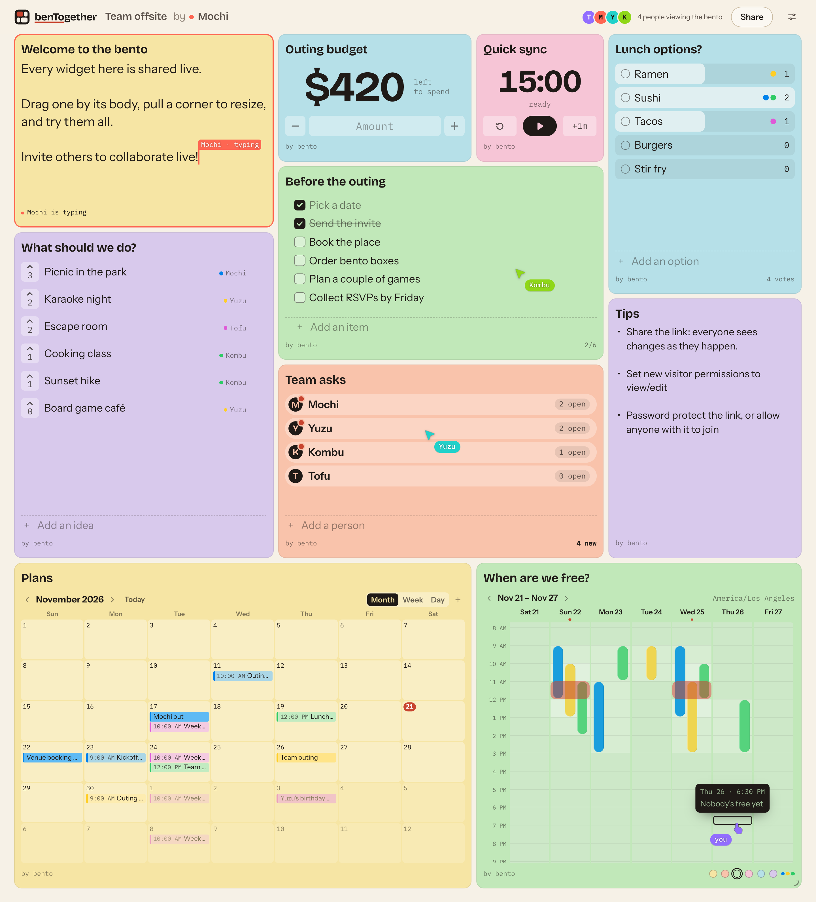
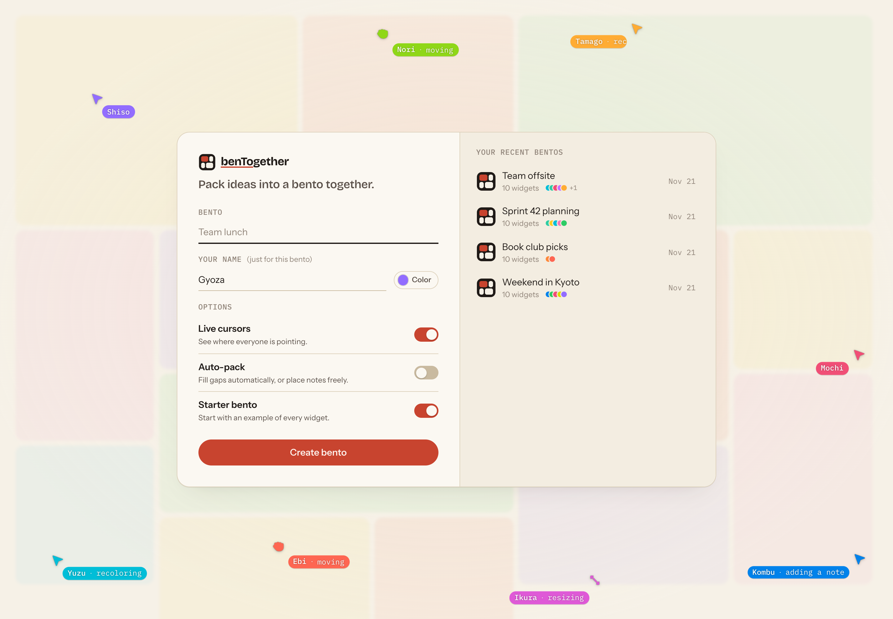

<h1>
  
  benTogether
</h1>

_Pack ideas into a bento together._

A live, multiplayer bento board. Share a link and everyone can contribute to notes, tasks, polls, events, and more.

Built with [Solid 2.0](https://www.solidjs.com/) on the client and Cloudflare Durable Objects. More detail: [Solid 2.0 notes](docs/SOLID-2.md) · [brand guide](docs/BRAND.md).

Vercel deployed example (https://bentogether.vercel.app/) runs on a Cloudflare free plan for demo purposes.

<picture>
  <source media="(prefers-color-scheme: dark)" srcset="docs/images/starter-board-dark.png">
  
</picture>

<details>
<summary>Home screen</summary>

<picture>
  <source media="(prefers-color-scheme: dark)" srcset="docs/images/home-dark.png">
  
</picture>

</details>

## Features

- Live cursors, typing carets and drag previews for everyone in a box
- Supports collaborative editing, scheduling, and viewing across several users
- Bentos can be shared via link with options to password gate on entry
- Auto-pack reflow toggle (freeform placement of widgets vs packing upwards)
- Permission Management (view/edit) per person, and only the creator or a widget's author can delete it
- Same layout and line wraps for everyone, at any screen size

**Widgets**

| Widget     | What it does                                                                                                                  |
| ---------- | ----------------------------------------------------------------------------------------------------------------------------- |
| Note       | Drag, resize, recolor, set text size. `- ` starts a list; headings, **bold**, _italic_, `code` and `[ ]` boxes show formatted |
| To-do      | A title line and items anyone can add, tick, edit, reorder and clear                                                          |
| Budget     | A shared total to spend from: type an amount and press − or +, with a history of who changed it                               |
| Timer      | One countdown for everyone, counted on each screen from the server's clock                                                    |
| Poll       | A question with options; everyone votes, viewers too                                                                          |
| Ideas      | Pitch ideas and upvote the best (viewers can upvote)                                                                          |
| Asks       | What each teammate needs and how many are open; a dot marks anything new since you last looked                                |
| Free times | Paint the half hours you're free over a week, shown in your own time zone                                                     |
| Calendar   | Month, week and day views; events in each viewer's own time                                                                   |

## Architecture


Each box is one Durable Object. Browsers talk to it over a single WebSocket; the Worker in front
only checks the origin, creates boxes and routes the socket. All of a box's rules live in `Room`,
a pure class with no I/O, so they're unit-tested in plain Node.

| Path              | What                                                                    |
| ----------------- | ----------------------------------------------------------------------- |
| `packages/shared` | Wire protocol, grid geometry, `settle` layout, note text OT (`text.ts`) |
| `apps/realtime`   | Cloudflare Worker + `Box` Durable Object; `Room` holds all box rules    |
| `apps/web`        | Solid 2.0 client (Vite), deployed to Vercel                             |
| `e2e`             | Playwright tests with two or three real browsers in one box             |

### How a change travels


- **Server is authoritative.** Clients send ops; the Durable Object validates, applies and
  broadcasts them. Your screen shows a guess straight away (an optimistic overlay) that settles to
  the server's answer, or reverts if it's rejected.
- **Confirmed means saved.** A change is written to SQLite in the same event that confirms it, so
  the Durable Object's output gate holds the confirmation until it's durable. Only typed note text
  is coalesced and flushed every 1.5 s.
- **Shared layout.** The same `settle()` runs on server and client, so drag previews match what
  lands.
- **Grid units everywhere.** Every viewer sees the same layout and line wraps at any screen size.
- **Permissions are server-side.** Owner token (hashed), roles per device, PBKDF2 passwords.

### Typing together


Typing merges, it doesn't lock. Each batch of keystrokes is an edit (keep / insert / delete)
against a numbered version of the note. The Durable Object puts edits in one order and moves a
late edit past the ones it missed (operational transform). Each client keeps one edit in flight
and moves its own unconfirmed typing past everyone else's. After a reconnect, unanswered typing is
sent again and the server replays what was missed, so nothing is applied twice.

## Develop

Requires Node 22.12+.

```bash
npm install
```

```bash
npm run dev
```

Web app on `localhost:5173`, realtime server on `localhost:8787`.

Format, lint, typecheck and unit tests:

```bash
npm run check
```

Multiplayer browser tests:

```bash
npm run e2e
```

## Deploy

**Realtime (Cloudflare):** set `ALLOWED_ORIGINS` under `env.production` in
`apps/realtime/wrangler.jsonc`, then run:

```bash
npm run deploy -w @bentogether/realtime
```

**Web (Vercel):** import the repo, set Root Directory to `apps/web`, and set `VITE_REALTIME_URL`
to the Worker URL.

CI runs checks and e2e on every push. It also deploys the Worker from `main` when the
`CLOUDFLARE_API_TOKEN` and `CLOUDFLARE_ACCOUNT_ID` secrets are set.

<sub>Diagrams are hand-written SVGs in `docs/images/`; they follow the colors in the
[brand guide](docs/BRAND.md) and switch with your light or dark theme.</sub>
